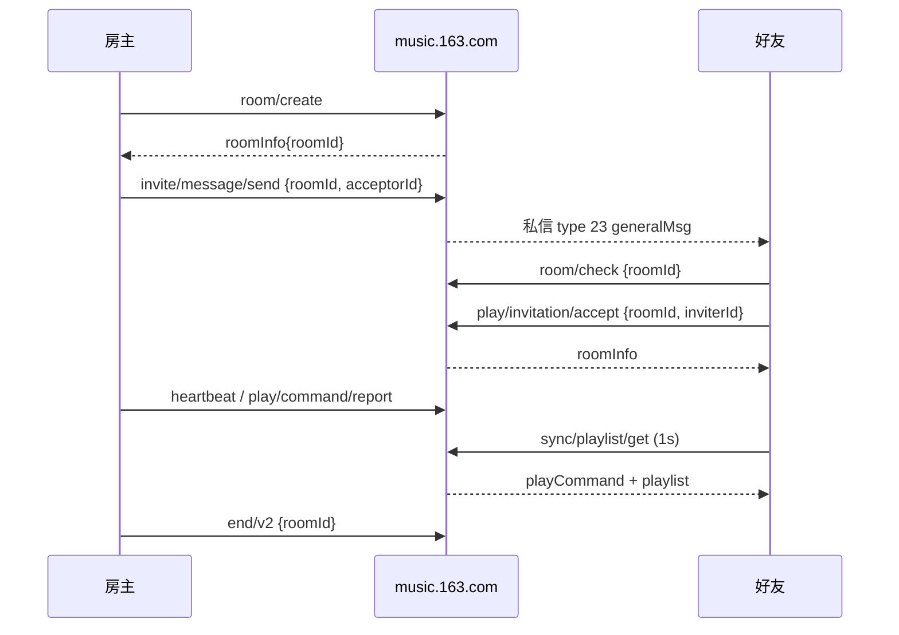

# 剩余功能的后端规格（社交优先）

这份文档只回答一件事：**进度表里还没接的功能，后端到底怎么调**。一起听、私信、动态/话题优先；歌单、云盘、账户、搜索等放在后半部分。

- OpenAPI 契约：`docs/openapi/openapi.yaml`（校验：`npx --yes @redocly/cli lint docs/openapi/openapi.yaml`）
- 一起听的 typed C++ SDK：`src/sdk/listen_together.h/.cpp`；测试：`src/tests/listen_together_test.cpp`

## 依据与边界

- 请求/响应形状来自公开接口文档、社区实现（`ncm-api-enhanced` 等）与本机只读请求复核；未验证字段会明确标注。
- 标注：`[线上]`、`[库]`、`[实测]`、`[推断]`。没标 `[实测]` 的回包字段都可能随服务端变化。
- 依据只覆盖公开可观察的 Web 行为。

鉴权边界仍是 `BACKEND.md` 的 Web cookie：`MUSIC_U` + `__csrf`，只走 `/api`、`/weapi`、`os=pc`。本文列出的社交端点都能在 Web 会话下工作，因此不需要 `eapi`/`xeapi`、也不需要 Android/macOS 专有标识。

### 传输形态

- 读：`GET /api/<path>?<query>` 明文即可；已实测匿名可读热搜、相似歌单。
- 写：`POST /weapi/<path>`，body 为 `params=<base64>&encSecKey=<hex>`，query 带 `csrf_token`；网页端的请求层在 `__csrf` 存在时会把 `/api/` 自动改写成 `/weapi/` 并加密。
- 一部分社交写接口也接受明文 `POST /api/<path>` 表单（一起听、私信发送现在是这么走的）。两种都行时优先 `/weapi`，和网页端保持一致；失败分类沿用 `NcmClient::failureOf()`。
- 业务码：`200` 成功；`301` 未登录/会话过期；`250` 设备风控；`405`/`-460` 限流；`488` 一起听房间已失效。写操作**不重试**。

---

## 1. 一起听

现有 `src/sdk/listen_together.*` 已经覆盖房间生命周期、心跳、播放指令与歌单同步。下面按「现有」与「还缺」分开。



### 1.1 房间生命周期

| 端点 | 传输 | 参数 | 回包要点 | 状态 |
|---|---|---|---|---|
| `/api/listen/together/room/create` | POST 明文 | `refer=songplay_more` | `data.roomInfo{roomId, chatRoomId, creatorId, roomUsers[], agoraChannelId}` | 现有 |
| `/api/listen/together/room/check` | POST 明文 | `roomId` | `data{joinable, type, status, copywriting}`；`type=sameRoom` 表示已在该房间 | 现有 |
| `/api/listen/together/play/invitation/accept` | POST 明文 | `refer`, `roomId`, `inviterId` | 同 `roomInfo`；`refer` 可用 `inbox_invite` / `third_party_invite` / `sysaction_reminder` | 现有 |
| `/api/listen/together/status/get` | POST 明文 | 空 | `data{inRoom, roomInfo, status}` | 现有 |
| `/api/listen/together/end/v2` | POST 明文 | `roomId` | `data.result` 或 `data.success` | 现有 |
| `/api/listen/together/end` | POST 明文 | `roomId` | 旧版结束接口 | 网页端仍在；不要新接 |

`roomInfo` 里的 `roomId` 是字符串，不要转成数字。`roomUsers[]` 每项至少带 `userId`、`nickname`、`avatarUrl`；挂件与身份图标是可选的展示字段。

### 1.2 心跳与播放指令

**心跳** `POST /api/listen/together/heartbeat`：

```text
roomId, songId, playStatus(PLAY|PAUSE), progress(毫秒), playlistVersion?
```

`playlistVersion` 是紧凑 JSON 数组，让服务器合并多方歌单版本：

```json
[{"userId":123,"version":4},{"userId":456,"version":2}]
```

**播放指令** `POST /api/listen/together/play/command/report`：

```text
roomId, commandInfo=<紧凑 JSON 字符串>
```

`commandInfo`：

```json
{
  "commandType": "PLAY|PAUSE|GOTO|seek|NEXT|PREV",
  "progress": 12345,
  "playStatus": "PLAY",
  "formerSongId": "108485",
  "targetSongId": "108486",
  "clientSeq": 17
}
```

`formerSongId`/`targetSongId` 接口发字符串；服务器也接受数字。`clientSeq` 单调递增，用来丢弃回声。`commandType` 大小写按上表；接收端对 `PLAY`/`PLAYING` 都要容错。

### 1.3 歌单同步

**拉取** `POST /api/listen/together/sync/playlist/get`：

```text
roomId, playlistParam=<紧凑 JSON 字符串，可选>
```

网页端只传 `roomId` 也能拿到缓存；但要让「房主改队列、其他人在 1 秒内看到」稳定生效，`playlistParam` 要带本地队列与版本：

```json
{
  "displayList": ["108485", "108486"],
  "randomList": ["108485", "108486"],
  "anchorSongId": "108485",
  "anchorPosition": 0,
  "clientSeq": 17,
  "playMode": "ORDER_LOOP"
}
```

回包：

```text
data.playCommand{userId, commandType, progress, playStatus, formerSongId, targetSongId, clientSeq, serverSeq}
data.playlist{
  displayList{result[], changed},
  randomList[],
  replace|replaced,
  version[{userId, version}],
  playMode
}
```

`changed=false` 且 `replace=false` 表示这次没有新队列，**不能**用空列表覆盖本地；`displayList` 为空时才用 `randomList` 兜底。

**上报整份队列** `POST /api/listen/together/sync/list/command/report`：

```text
roomId, playlistParam=<紧凑 JSON 字符串>, clientSeq
```

`playlistParam`：

```json
{
  "commandType": "REPLACE",
  "version": [{"userId":123,"version":5}],
  "anchorSongId": "108485",
  "anchorPosition": 0,
  "randomList": ["108485","108486"],
  "displayList": ["108485","108486"],
  "clientSeq": 18,
  "playMode": "ORDER_LOOP"
}
```

自己这一份 `version` 加一，其他成员的版本原样带回；只带自己的版本时对方列表不会变。

### 1.4 邀请好友（还缺的部分）

| 端点 | 参数 | 用途 | 证据 |
|---|---|---|---|
| `/api/listen/together/multi/invite` | `roomId`, `groupIds="[]"`, `inviteUids="[uid,...]"`, `csrf_token` | 直接邀请多个好友；现有实现已 live 验证 | `[实测]` `PROGRESS.md` |
| `/api/listen/together/invite/message/send` | `roomId`, `acceptorId` | 网页端的「邀请好友」消息卡：给单个好友发一起听邀请 | `[线上]` 调用点 `Rc({roomId, acceptorId})`；参数 `[推断]`，未 live |
| `/api/listen/together/mutual/follows/get/v2` | 空 | 好友在听/在线/已在房间标记；当前 `friend_listening` 已用 | `[线上]` + 现有 |

`invite/message/send` 与 `multi/invite` 不是同一条链路：前者会在私信里落一条邀请消息（收件人从信箱点进房间），后者是房间级批量邀请。要做「邀请好友」面板，两个都需要；只做「已在线好友一键进房」可以先用 `multi/invite`。`invite/message/send` 回包按 `code=200` 判断，`488` 表示房间已失效。

邀请消息本身是私信 `type 23`（`generalMsg`）：

```text
generalMsg.nativeUrl = orpheus://nm/play/listenTogether?roomId=<roomId>&inviterId=<uid>
generalMsg.webUrl    = 网页兜底
```

收件端解析 `roomId`/`inviterId` 后先 `room/check`，再 `invitation/accept`。

### 1.5 房间内的社交数据（还缺的部分）

**双方关系与时长统计** `POST /api/listen/together/relation/statistics/get/v2`：

```text
roomId, roomUserIds=<JSON 数组字符串，例如 ["123","456"]>
```

网页端用「房主 + 另一位成员」两个 id。回包 `data` 是该组合的累计一起听时长/次数统计；字段未在公开行为 里展开，按 `data` 原样展示即可。

**歌曲权限** `POST /api/listen/together/privilege/get`：

```text
otherUserId, trackIds=[...]
```

回包 `data.result[]`：

```text
songId, playable, unplayableType,
unplayableUserIds[], unplayableOuterIds[]
```

用途：房间成员里有人没有版权/VIP 时，客户端要跳过或提示，而不是让所有人一起卡住。`trackId` 在公开实现里是从 `songId` 改名的，解析时以 `songId` 为准。

**VIP 赠送** `POST /api/listen/together/vip/gift/report`：

```text
sku, receiver, roomId
```

网页端在房间里送会员时调用；`receiver` 是对方 uid。回包按 `code=200` 判断成功；`sku` 从商城/权益接口取，不应硬编码。

**歌单变更提醒** `POST /api/listen/together/sync/notice`：

```text
roomId
```

网页端在队列变化后会调用这个路由，但调用点只看到参数对象透传，没有展开字段。先只传 `roomId` 试；失败就继续靠 1 秒轮询，不影响正确性。

### 1.6 错误处理

- `488`：房间已失效/被解散。收到后立即 `clearRoom()`，提示「一起听已失效，可邀请好友进入新的房间」，不要重试。
- `405`/`-460`：心跳或上报太密。降低频率，不要把失败的指令塞回队列。
- `301`：会话过期，走现有 cookie 刷新；刷新失败回登录。
- 心跳与指令上报失败不阻塞本地播放；状态栏保留一次错误即可。

---

## 2. 私信

现有 `src/store_inbox.cpp` 已经能读会话/历史并发送文本与歌曲。下面把完整消息面补齐。

### 2.1 会话与历史

**会话列表** `POST /weapi/msg/private/users`：

```json
{"offset": 0, "limit": 30, "total": "true"}
```

回包：`code`, `msgs[]`, `newMsgCount`, `more`。每个会话：

```text
userId, nickname, avatarUrl, lastMsg, lastMsgId, lastTime, unread, messageCount
```

当前 Store 已归一化成 `inbox` / `inbox:<offset>`，分页用 `offset + msgs.size()`。

**历史** `POST /weapi/msg/private/history`：

```json
{"userId": 123, "limit": 30, "time": 0, "total": "true"}
```

`time=0` 取最新一页；更早一页传上一页最后一条的 `time`。回包 `msgs[]`, `more`。每条：

```text
id, fromUser{userId,nickname,avatarUrl,...}, toUser{...},
msg=<JSON 字符串>, time, batchId
```

`msg` 解析后按 payload 分类：`song` / `album` / `playlist` / `mv` / `program` / `event` / `dj` / `picInfo`（图片）/ `generalMsg`（卡片、一起听邀请）/ `promotionUrl`（推广）。文本消息的正文在 `msg` 字段的 `msg` 键。

### 2.2 发送

`POST /api/msg/private/send`，明文表单；带 `csrf_token`。

文本：

```text
type=text, msg=<正文>, userIds=<JSON 数组字符串，例如 "[123]">
```

歌曲：

```text
type=song, id=<songId>, msg=<附言>, userIds=<JSON 数组字符串>
```

同一端点也接受 `album` / `playlist` / `mv` / `program` 资源卡；转发评论用 `type=comment` 并额外带 `threadId`。图片消息是：

```text
type=pic, picinfo=<JSON 字符串>, userIds=<JSON 数组字符串>
```

`picinfo` 需要先走图片上传（见 5.2）拿到 `docId`，再传：

```json
{"picIdStr":"<docId>","width":800,"height":800,"format":"jpg","type":0}
```

回包以 `newMsgs[]` 为准：`{"code":200,"newMsgs":[{id,fromUser,toUser,msg,time,...}]}`。网页端直接用 `newMsgs` 更新会话；当前 Store 只看根级 `id`，接入时应优先读 `newMsgs`，`id` 仅作兼容。`code=2202` 表示发送被拒（对方拒收/不能发给自己），不是成功。发送成功后重新拉当前会话与列表，不要本地伪造消息。

回复没有单独接口：回复就是再发一次 `type=text`，`userIds` 仍是对方 uid。没有 `replyTo` 字段。

### 2.3 删除与已读

网页端有这些路由，但参数没有在其 JS 调用点里展开；接入前先 live 取一次。

| 端点 | 已知 | 说明 |
|---|---|---|
| `/api/msg/private/delete` | 网页端路由 | 删除整个会话；参数名未确认 |
| `/api/msg/private/delete/single` | 网页端路由 | 删除单条消息；参数名未确认 |
| `/api/msg/notice/delete` | 网页端路由 | 删除通知；参数名未确认 |
| `/api/msg/count/clear` | 网页端路由 | 清未读数；参数名未确认 |
| `/api/msg/recentcontact` | 网页端路由 | 最近联系人 |
| `/api/msg/notices` | `{limit, lasttime}` | 系统通知；现有 `notify` 已接 |

删除类操作按「乐观更新 + 失败回滚」做，且不应重试。参数确认前不要猜 `msgIds`/`sessionId`，否则容易删错会话。

### 2.4 资源分享与邀请卡

- `/api/share/friends/resource`：`{type, msg, id}`，网页端的分享到好友/动态入口。参考库对该端点使用 `xeapi` v3；在当前 Web cookie 边界下先用 `weapi` 验证，失败就退回 `msg/private/send` 的资源卡，不要引入 `xeapi`。
- `/api/listen/together/invite/message/send`：见 1.4。邀请卡是 `type 23 generalMsg`，不是普通文本。

---

## 3. 动态与话题

### 3.1 动态

| 端点 | 传输 | 参数 | 回包/说明 |
|---|---|---|---|
| `/api/v1/event/get` | weapi | `pagesize`, `lasttime` | 动态流 |
| `/api/event/get/<uid>` | 明文 | `getcounts`, `time`, `limit`, `total`, `fromRN` | 用户主页动态；现有已接 |
| `/api/event/forward` | 明文 | `forwards`, `id`, `eventUserId` | 转发；`forwards` 是附言 |
| `/api/event/delete` | weapi | `id` | 删除自己的动态 |
| `/api/event/privacy/op` | 明文 | `eventId`, `privacy` | `0` 所有人、`1` 我关注的人、`2` 仅自己、`6` 互关 |
| `/api/share/friends/resource` | 网页端| `type`, `msg`, `id` | 分享歌曲/歌单/专辑/MV/节目/纯文本到动态；参考库用 xeapi，需实测 weapi |

动态评论沿用评论读取：`threadId=A_EV_2_<eventId>`。

### 3.2 话题

| 端点 | 传输 | 参数 | 说明 |
|---|---|---|---|
| `/api/act/hot` | weapi | `limit`, `offset` | 热门话题；匿名 `301`，需登录 |
| `/api/act/detail` | weapi | `actid` | 话题详情 |
| `/api/act/event/hot` | weapi | `actid` | 话题下的热门动态 |
| `/api/topic/sub` | 明文 | `id`（话题 id） | 收藏话题；参数 `[推断]` |
| `/api/topic/unsub` | 明文 | `id` | 取消收藏 |
| `/api/topic/sublist` | weapi | `limit`, `offset`, `total` | 收藏的话题 |
| `/api/v1/search/topic/get` | 网页端| 搜索词 | 搜索话题 |

话题接口都需要登录；匿名只验证到 `301`，没有可用的公开回包。

---

## 4. 评论互动

线程 id 固定映射（来自参考库 `resourceTypeMap`）：

```text
0 R_SO_4_   歌曲
1 R_MV_5_   MV
2 A_PL_0_   歌单
3 R_AL_3_   专辑
4 A_DJ_1_   电台
5 R_VI_62_  视频
6 A_EV_2_   动态
7 A_DR_14_  电台节目
```

| 能力 | 端点 | 传输 | 参数 |
|---|---|---|---|
| 歌曲/歌单点赞 | `/api/v1/comment/like` / `unlike` | weapi | `threadId`, `commentId` |
| 抱一抱 | `/api/v2/resource/comments/hug/listener` | weapi | `targetUserId`, `commentId`, `threadId` |
| 抱一抱列表 | `/api/v2/resource/comments/hug/list` | weapi | `targetUserId`, `commentId`, `cursor=-1`, `threadId`, `pageNo=1`, `idCursor=-1`, `pageSize=100` |
| 举报评论 | `/api/report/reportcomment` | weapi | `threadId`, `commentId`, `reason` |
| 删除评论 | `/api/resource/comments/delete` | 网页端`/api` | `commentId`, `threadId`；参考库用 xeapi，需实测 weapi |
| 举报原因 | `/api/report/type/get` | 线上路由（未验证） | 参数未确认 |

- `reason` 是举报面板给的整数原因码，网页端代码只透传，没有内置枚举；先做「其他」一个原因，拿到真实原因列表后再展开。
- 歌单评论点赞就是把 `threadId` 换成 `A_PL_0_<playlistId>`；读取侧已经有 `A_PL_0_` 的解析。
- 评论写入（发评论/回复）仍是 `xeapi` + 易盾，维持「不做」。

---

## 5. 其余剩余功能（简表）

### 5.1 歌单

| 能力 | 端点 | 传输 | 参数 |
|---|---|---|---|
| 隐私 | `/api/playlist/update/privacy` | weapi | `id`, `privacy`（`0` 公开 / `10` 私密） |
| 封面 | `/api/playlist/cover/update` | weapi | `id`, `coverImgId`；回包带新的 `url` |
| 导入 | `/api/playlist/import/name/task/create` | weapi | `local` 或 `songs` + `playlistName` + `importStarPlaylist`；回包 `data.taskId` |
| 导入状态 | `/api/playlist/import/task/status/v2` | weapi | `taskIds=<JSON 数组字符串>`；`data` 为任务状态，字段未验证 |
| 收藏 | `/api/playlist/subscribe` / `unsubscribe` | weapi | `id` |

收藏的 `405` 是限流，不是端点错误：写请求单发、失败不重试、连续操作只保留最后一次。参考库为了绕风控用了 `eapi` + `checkToken`，那条路不在当前鉴权边界内。

导入的 `songs` 结构：

```json
[{"name":"<歌单名>","type":"","url":"<encodeURI('rpc://playlist/import?text=...')>"}]
```

本地元数据导入则传 `local=JSON.stringify([{name,artist,album}])`。

### 5.2 图片上传（歌单封面 / 头像 / 私信图片共用）

1. `POST /weapi/nos/token/alloc`

```json
{"bucket":"yyimgs","ext":"jpg","filename":"cover.jpg","local":false,
 "nos_product":0,"return_body":"{\"code\":200,\"size\":\"$(ObjectSize)\"}",
 "type":"other"}
```

2. 回包 `result{objectKey, token, docId}`；把图片字节 `POST` 到
   `https://nosup-hz1.127.net/yyimgs/<objectKey>?offset=0&complete=true&version=1.0`，
   header 带 `x-nos-token: <token>` 与图片 `Content-Type`。
3. `docId` 就是歌单封面的 `coverImgId`、头像的 `imgid`、私信图片的 `picIdStr`。

### 5.3 云盘

| 步骤 | 端点 | 传输 | 参数 |
|---|---|---|---|
| 秒传检查 | `/api/cloud/upload/check` | 明文 | `bitrate`, `ext`, `length`, `md5`, `songId=0`, `version=1`；回包 `needUpload`, `songId` |
| 上传凭据 | `/api/nos/token/alloc` | weapi | `bucket=jd-musicrep-privatecloud-audio-public`, `ext`, `filename`, `local=false`, `nos_product=3`, `type=audio`, `md5` |
| 上传地址 | `GET https://wanproxy.127.net/lbs?version=1.0&bucketname=<bucket>` | — | 取 `upload[0]` |
| 上传 | `POST <lbs.upload[0]>/<bucket>/<objectKey>?offset=0&complete=true&version=1.0` | — | `x-nos-token`, `Content-MD5`, `Content-Type`, `Content-Length` |
| 落库 | `/api/upload/cloud/info/v2` | 明文 | `md5`, `songid`, `filename`, `song`, `album`, `artist`, `bitrate`, `resourceId` |
| 发布 | `/api/cloud/pub/v2` | 明文 | `songid` |
| 删除 | `/api/cloud/del` | weapi | `songIds=[id]` |
| 列表 | `/api/v1/cloud/get` | weapi | `limit`, `offset` |
| 导入检查 | `/api/cloud/upload/check/v2` | 明文 | `uploadType=0`, `songs=JSON.stringify([{md5,songId,bitrate,fileSize}])`；`data[0].upload` 0 可导入 / 1 已存在 / 2 不可导入 |
| 导入落库 | `/api/cloud/user/song/import` | 明文 | `uploadType=0`, `songs=JSON.stringify([{songId,bitrate,song,artist,album,fileName}])` |
| 下载 | `/api/cloud/dowonload` | eapi | `songId`；当前边界内优先走已有 `song/enhance/player/url/v1` |

网页端的云盘上限是 `maxPrivateCloudUploadSize=104857600`（100 MB）。上传本身不走 `music.163.com`，不要给 NOS 请求带 `MUSIC_U`。

### 5.4 账户

| 能力 | 端点 | 传输 | 参数 |
|---|---|---|---|
| 手机登录 | `/api/w/login/cellphone` | weapi | `type=1`, `https=true`, `phone`, `countrycode=86`, `password=<md5>` 或 `captcha`, `remember=true`, `secureCaptcha` |
| 邮箱登录 | `/api/w/login` | weapi | `username`, `password=<md5>`, `rememberLogin=true` |
| 验证码 | `/api/sms/captcha/sent` | weapi | `ctcode=86`, `secrete=music_middleuser_pclogin`, `cellphone` |
| 验证码校验 | `/api/sms/captcha/verify` | weapi | `ctcode`, `cellphone`, `captcha` |
| 资料编辑 | `/api/user/profile/update` | weapi | `nickname`, `signature`, `gender`, `birthday`, `province`, `city`, `avatarImgId?` |
| 头像 | `/api/user/avatar/upload/v1` | weapi | `imgid=<docId>`（先走 5.2） |
| VIP 信息 | `/api/music-vip-membership/client/vip/info` | weapi | `userId?`；`data` 里 `associator{expireTime,vipLevel,iconUrl}`, `redplus{expireTime,vipLevel}`, `musicPackage{expireTime}` |
| VIP 任务 | `/api/vipnewcenter/app/level/task/list` | weapi | 空 |
| 签到 | `/api/vip-center-bff/task/sign` | weapi | 空；返回 `data` |
| 签到历史 | `/api/vipnewcenter/app/level/user/checkin/history/list` | weapi | 空 |
| 签到详情 | `/api/vipnewcenter/app/level/user/checkin/history/detail` | eapi | `signDayTime`, `type=1`；当前边界内只做前半段 |

手机/邮箱登录是新增鉴权入口，扫码登录仍是默认；密码只以 md5 传输，不要落盘。

### 5.5 搜索与曲目扩展

| 能力 | 端点 | 传输 | 参数/回包 |
|---|---|---|---|
| 热搜详情 | `/api/hot/search/info/get` | 明文 GET | 无参；`data.hotSearches[]`：`searchWord`, `toUserWord`, `score`, `iconType`, `iconUrl`, `content`, `url`, `alg?`；`[实测]` |
| 热搜（旧） | `/api/hotsearchlist/get` | 明文 | 无参；`data[]` 同字段；`[实测]` |
| 热搜关联歌曲 | `/api/hot/search/relate/song/get` | 明文 | `searchWord`；匿名实测空回包，需登录/参数待验 |
| 歌词摘录 | `/api/song/play/lyrics/mark/song` | 明文 POST | `songId`；需登录，匿名 `301` |
| 摘录本 | `/api/song/play/lyrics/mark/user/page` | 明文 | `limit`, `offset` |
| 添加摘录 | `/api/song/play/lyrics/mark/add` | 明文 | `songId`, `markId?`, `data=<JSON 数组字符串>` |
| 删除摘录 | `/api/song/play/lyrics/mark/del` | 明文 | `markIds` |
| 包含这首歌的歌单 | 无 JSON 接口 | — | 见下 |

「包含这首歌的歌单」在网页端里没有 JSON 端点；只有歌曲网页服务端渲染的区块。要接只能抓 HTML：

```text
GET https://music.163.com/song?id=<songId>
```

区块里每个卡片是 `div.cver.u-cover.u-cover-3`，取 `img[src]`、`a.sname[href^="/playlist?id="]`、创建者 `a.nm[href^="/user/home?id="]`。这是网页结构，不是稳定 API；缓存 1 小时、失败静默，不要因为改版阻塞播放页。

---

## 6. 还没写入契约的候选接口

只列对用户有感知、且不越过 Web cookie 边界的；广告、抽奖、云贝、音乐人后台、粉丝中心不列。状态：

- `已实现`：C++ 已有请求/解析。
- `已写入`：在 OpenAPI 或本文前面有请求规格，但 C++ 还没接。
- `未写入`：只知道路由/用途，参数或回包还没确认。

### 6.1 社交与一起听（优先）

| 能力 | 端点 | 价值 | 状态 |
|---|---|---|---|
| 房间权限变更 | `/api/listen/together/privilege/change/report` | 成员买/失去 VIP 后让房间刷新可播状态 | 未写入；参数未确认；可先靠 `privilege/get` 轮询 |
| 删除私信会话 | `/api/msg/private/delete` | 清理信箱 | 已写入；参数未确认 |
| 删除单条私信 | `/api/msg/private/delete/single` | 删除单条消息 | 已写入；参数未确认 |
| 删除通知 | `/api/msg/notice/delete` | 清理通知 | 已写入；参数未确认 |
| 未读清零 | `/api/msg/count/clear` | 消息角标清零 | 已写入；参数未确认 |
| 最近联系人 | `/api/msg/recentcontact` | 发私信时快速选人 | 已写入；回包未确认 |
| 评论抱一抱 | `/api/v2/resource/comments/hug/listener`、`/hug/list` | 评论互动 | 已写入；C++ 未接 |
| 评论举报/删除 | `/api/report/reportcomment`、`/api/resource/comments/delete` | 评论治理 | 已写入；C++ 未接；删除需实测 weapi |
| 歌单评论点赞 | `/api/v1/comment/like`（`A_PL_0_`） | 歌单评论互动 | 已写入；C++ 未接 |
| 动态转发/删除/可见性 | `/api/event/forward`、`/delete`、`/privacy/op` | 用户动态管理 | 已写入；C++ 未接 |
| 分享到好友/动态 | `/api/share/friends/resource` | 资源分享 | 已写入；参考实现用 xeapi，需实测 |
| 话题 | `/api/act/hot`、`/act/detail`、`/act/event/hot`、`/topic/sub|unsub|sublist` | 社区内容 | 已写入；C++ 未接 |
| 举报用户/资源/动态 | `/api/report/reportuser`、`/reportresource`、`/reportevent` | 安全与治理 | 未写入 |
| 拉黑/取消拉黑 | `/api/blacklist/add`、`/delete`、`/music-blacklist/*` | 减少骚扰、调整推荐 | 未写入 |
| 短链生成 | `/api/middle/shorturl/generate` | 一起听/分享链接更短 | 未写入；参数未确认 |

### 6.2 内容与媒体

| 能力 | 端点 | 价值 | 状态 |
|---|---|---|---|
| 云盘歌词 | `/api/cloud/lyric/get` | 云盘歌曲歌词 | 未写入 |
| 云盘匹配 | `/api/cloud/match` | 上传/导入时匹配曲目 | 未写入 |
| 云盘歌曲详情 | `/api/user/cloud/detail` | 云盘单曲详情 | 未写入 |
| 云盘下载 | `/api/cloud/dowonload`、`/api/song/cloud/download` | 离线播放云盘 | 未写入；eapi，需评估 |
| 电台节目批量详情 | `/api/dj/program/batch/detail` | 减少逐条请求 | 未写入 |
| 节目内歌曲 | `/api/dj/program/song/musics` | 节目曲目列表 | 未写入 |
| 电台分类/排行 | `/api/dj/radio/category/*`、`/api/dj/toplist/*` | 发现页分类 | 未写入 |
| 付费节目检查 | `/api/dj/play/url/check`、`/api/dj/voices/download/check` | 付费/版权提示 | 未写入 |
| 视频收藏/取消 | `/api/cloudvideo/video/sub|unsub` | 视频页收藏 | 未写入；SDK 目录已有列表 |
| MLog 视频 | `/api/mlog/detail/v1`、`/mlog/mycollect/bytime/get`、`/mlog/artist/video` | 视频动态 | 未写入 |
| MV 下载点数 | `/api/mv/download/point/consume` | MV 下载 | 未写入 |
| 歌词搜索 | `/api/search/resource/lyric` | 用一句歌词找歌 | 未写入；很有用户价值 |
| 最佳匹配/多匹配 | `/api/search/bestmatch/get`、`/search/multimatch` | 搜索直达 | 未写入 |
| 声音/播客搜索 | `/api/search/voice/get`、`/search/voicelist/get` | 播客搜索 | 未写入 |
| 话题搜索 | `/api/v1/search/topic/get`、`/v2/search/topic/get` | 社区搜索 | 已写入（v1） |
| 播放历史管理 | `/api/play-record/delete`、`/batch/delete`、`/clear` | 隐私清理 | 未写入 |
| 最近播放分类 | `/api/play-record/album|playlist|song|voice/list` | 「最近播放」分栏 | 未写入 |
| 歌曲特征/红心数 | `/api/song/feature/detail`、`/song/red/count` | 曲目信息 | 未写入 |
| 歌曲版权推荐 | `/api/song/copyright/rcmd` | 无版权时替代推荐 | 未写入 |
| 歌单相关推荐 | `/api/playlist/detail/rcmd/get` | 歌单页「相关歌单」 | 未写入 |
| 歌单标签/排序 | `/api/playlist/tags/update`、`/playlist/order/update` | 歌单管理 | 未写入 |
| 歌单订阅者 | `/api/playlist/subscribers` | 歌单社交证明 | 未写入 |
| 歌单内视频 | `/api/playlist/video/recent` | 视频歌单 | 未写入 |
| 首页日推变体 | `/api/homepage/category/daily/song/list`、`/homepage/more/rcmd/song`、`/pc/daily/rcmd/block` | 首页更多推荐 | 未写入 |
| 口味/不感兴趣 | `/api/personalized/taste`、`/personalized/dislike`、`/common/resource/dislike/reason` | 推荐调优 | 未写入 |
| 用户音频/电台/勋章 | `/api/user/audio`、`/user/dj`、`/user/medal` | 用户主页扩展 | 未写入 |
| 用户评论历史 | `/api/user/comments`、`/user/comments/reply` | 个人中心 | 未写入 |

### 6.3 账户、安全与商业化

| 能力 | 端点 | 价值 | 状态 |
|---|---|---|---|
| 账户设置 | `/api/user/setting`、`/user/setting/update` | 隐私/播放设置 | 未写入 |
| 绑定信息 | `/api/w/v1/user/bindings/{uid}`、`/user/bindingCellphone` | 账号绑定 | 未写入 |
| 两步验证 | `/api/user/2fa/begin`、`/user/2fa/list` | 账号安全 | 未写入 |
| 设备管理 | `/api/middle/user/device/list`、`/security/device/kickoff` | 登录设备 | 未写入 |
| 昵称检查 | `/api/nickname/duplicated`、`/nickname/hint/get` | 资料编辑校验 | 未写入 |
| 快速切换账号 | `/api/login/switchuser`、`/login/quicklogin`、`/login/getquickloginlist` | 多账号 | 未写入 |
| 新设备审批 | `/api/login/origin-device/*` | 登录安全 | 未写入 |
| VIP 成长值 | `/api/vip/growthpoint`、`/growthpoint/details`、`/growthpoint/get` | 会员任务 | 未写入 |
| VIP 时光机 | `/api/vip/timemachine` | 会员回顾 | 未写入 |
| VIP 商城 | `/api/vipmall/*` | 会员权益 | 未写入；商业化，优先级低 |

这些接口大多只需要补请求/解析；真正要先解决的是 `delete/notice/count`、`shorturl`、`privilege/change` 的参数确认，以及 `share/friends/resource` 能否在 weapi 下工作。确认后再进 OpenAPI，避免把猜测写进契约。


## 7. 明确不做 / 现在做不了

| 功能 | 原因 |
|---|---|
| 评论写入（发评论/回复） | `xeapi` + 易盾 token + 公钥轮换；维持 `PROGRESS.md` 的「不做」 |
| 动态发布（纯文本/资源） | 网页端的 `/api/share/friends/resource` 参考实现走 `xeapi` v3；先做转发，发布需单独验证 weapi |
| 听歌识曲 | 需要客户端生成 AFP 指纹：需要专用音频指纹库生成 AFP；桌面端没有等价实现，只有匹配端点 `/api/music/audio/match` 不够 |
| `/eapi` 专有接口 | 违反 `BACKEND.md` 的鉴权边界 |
| 歌单收藏的 `checkToken` 绕行 | 参考库用 `eapi` + 易盾 token；当前边界内只能限速与退避 |

听歌识曲端点仅作记录：`GET https://interface.music.163.com/api/music/audio/match?sessionId=<16hex>&algorithmCode=shazam_v2&duration=<秒>&rawdata=<AFP>&times=1&decrypt=1`。

---

## 8. 实施顺序

1. **一起听补口**：`invite/message/send`（邀请好友落私信）、`privilege/get`（成员无版权时跳过）、`relation/statistics/get/v2`（房间时长）、`vip/gift/report`。
2. **私信补口**：删除会话/单条、通知删除、未读清零；先 live 确认参数名。资源分享先走 `msg/private/send`，不要为 `/api/share/friends/resource` 引入 `xeapi`。
3. **社交动作**：动态转发/删除/可见性、话题收藏、评论抱一抱/举报/歌单评论点赞。
4. **次要**：歌单隐私/封面/导入、云盘写入、账户资料/头像、热搜详情、歌词摘录。
5. **不做**：评论写入、动态发布、听歌识曲、eapi/xeapi。

